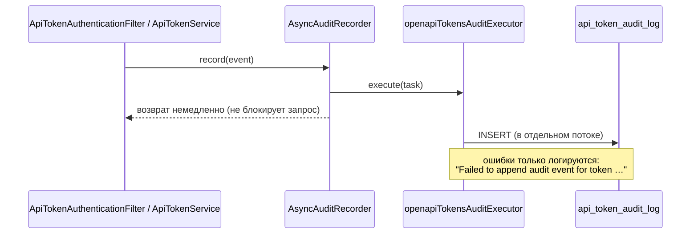

# Аудит и статистика

Библиотека ведёт журнал обращений по API-токенам и агрегированную статистику использования.
Это основа для расследований («какой токен и когда ходил в этот эндпоинт»), для отображения
активности в UI и для контроля «мёртвых» токенов.

## Что фиксируется

Событие аудита (`AuditEvent`) содержит:

| Поле | Тип | Описание |
|---|---|---|
| `tokenId` | `UUID` | Идентификатор токена (может отсутствовать, если токен не опознан) |
| `ownerId` | `String` | Владелец токена |
| `tenantId` | `String` | Тенант (может быть `null`) |
| `httpMethod` | `String` | `GET`, `POST`, … |
| `endpoint` | `String` | `request.getRequestURI()` — путь без query-строки |
| `action` | `String` | `AUTHENTICATE`, `CREATE_TOKEN`, `REVOKE_TOKEN`, `BLOCK_TOKEN`, `UNBLOCK_TOKEN` |
| `success` | `boolean` | Результат операции (у `AUTHENTICATE` — успех аутентификации) |
| `responseStatus` | `Integer` | Фактический HTTP-статус: 200/201/401/429/… |
| `ip` | `String` | `request.getRemoteAddr()` — IP клиента (без учёта `X-Forwarded-For`) |
| `userAgent` | `String` | Заголовок `User-Agent` |
| `createdAt` | `Instant` | Момент события (UTC, из бина `Clock`) |

!!! info "Два класса событий в одной таблице"
    **Аутентификация.** Пишется в `ApiTokenAuthenticationFilter` при попытке
    аутентификации по Bearer-токену: `action = AUTHENTICATE`, заполнены `httpMethod`,
    `endpoint`, `ip`, `userAgent`. Событие формируется **после** обработки запроса,
    поэтому `responseStatus` — настоящий статус ответа (не всегда 200).

    **Жизненный цикл.** Пишется сервисом (`DefaultApiTokenService`) в ту же таблицу:

    | `action` | Когда | `responseStatus` |
    |---|---|---|
    | `CREATE_TOKEN` | токен успешно сохранён | `201` |
    | `REVOKE_TOKEN` | `revoke()` / `forceRevoke()` | `200` |
    | `BLOCK_TOKEN` | `block()` / `forceBlock(block)` | `200` |
    | `UNBLOCK_TOKEN` | `unblock()` / `forceBlock(unblock)` | `200` |

    У событий жизненного цикла `httpMethod`, `endpoint`, `ip`, `userAgent` — `null`
    (запрос к этому моменту не обязательно HTTP), `success = true`, `ownerId`/`tenantId`
    берутся из токена.

    Если `AuditRecorder` заменён на `NoOpAuditRecorder` (`audit.enabled=false`),
    события жизненного цикла тоже не пишутся.

## Куда пишется

| Слой | Компонент | Поведение |
|---|---|---|
| Порт | `AuditRecorder#record(AuditEvent)` | Контракт записи |
| Реализация (по умолчанию) | `AsyncAuditRecorder` | Кладёт задачу в `Executor` и сразу возвращает управление |
| Реализация при `audit.async=false` | `SyncAuditRecorder` | Пишет в потоке вызывающего |
| Реализация при `audit.enabled=false` | `NoOpAuditRecorder` | Отбрасывает события |
| Исполнитель | бин `openapiTokensAuditExecutor` | `ThreadPoolTaskExecutor`, core 2 / max 4, **очередь 1000**, `CallerRunsPolicy`, graceful shutdown (await 5 c) |
| Порт хранилища | `AuditLogRepository` | `append`, `findByTokenId`, `usageStats` |
| Реализация | `JpaAuditLogRepository` | Таблица `api_token_audit_log` |



!!! info "Асинхронность и надёжность"
    Запись аудита не влияет на обработку запроса: сбой вставки **никогда** не пробрасывается
    клиенту и не откатывает основную транзакцию — ошибка попадает только в лог уровня `ERROR`.
    Очередь executor'а **ограничена** (1000) и использует `CallerRunsPolicy`: при
    переполнении запись выполняется в потоке вызывающего (замедляет запрос, но не теряет
    событие). При `RejectedExecutionException` (например, executor уже остановлен) событие
    логируется и отбрасывается. События не персистятся в очереди, поэтому при жёсткой
    остановке приложения часть записей может потеряться, а порядок записей не гарантирован.

    Порядок можно поменять на синхронный (`audit.async=false`) или полностью отключить
    аудит (`audit.enabled=false`) — см. настройки ниже.

## Настройки аудита

```yaml
openapi:
  tokens:
    audit:
      enabled: true          # false → NoOpAuditRecorder, события отбрасываются
      async: true            # false → SyncAuditRecorder (запись в потоке запроса)
      record-failures: true  # false → фильтр не пишет неуспешные AUTHENTICATE
```

| Свойство | По умолчанию | Что делает |
|---|---|---|
| `openapi.tokens.audit.enabled` | `true` | `false` → бин `AuditRecorder` = `NoOpAuditRecorder`; не пишутся ни `AUTHENTICATE`, ни события жизненного цикла |
| `openapi.tokens.audit.async` | `true` | `false` → `SyncAuditRecorder`; сбой по-прежнему только логируется, но запись идёт в потоке запроса |
| `openapi.tokens.audit.record-failures` | `true` | `false` → фильтр пропускает **неуспешные** `AUTHENTICATE` (401/429); успешные и события жизненного цикла пишутся всегда |

Все три свойства читаются автоконфигурацией при создании бина `AuditRecorder`/фильтра.
Свой бин `AuditRecorder` (`@ConditionalOnMissingBean`) по-прежнему перекрывает эти настройки.

!!! warning "Ротации журнала нет"
    Таблица `api_token_audit_log` растёт неограниченно. Уборку старых записей нужно
    организовать самостоятельно (партиционирование, cron-задача, `pg_cron`, внешний
    архиватор). Индексы `(token_id, created_at)` и `(created_at)` созданы в миграции V1.

## Чтение аудита

### Через REST

| Endpoint | Кто | `limit` по умолчанию | Максимум | Сортировка |
|---|---|---|---|---|
| `GET /api/openapi/tokens/{id}/audit?offset=&limit=` | владелец токена | 50 | 500 | `created_at DESC, id DESC` |
| `GET /api/openapi/admin/tokens/{id}/audit?offset=&limit=` | `ROLE_ADMIN` | 100 | 500 | `created_at DESC, id DESC` |

Оба эндпоинта принимают `offset` (`@Min(0)`, по умолчанию 0) и `limit`
(`@Min(1) @Max(500)`). Ответ — массив событий; общего количества (`total`) в ответе нет,
для UI-пагинации считайте по длине страницы.

Пример ответа (JSON-представление доменного `AuditEvent`):

```json
[
  {
    "tokenId": "0f9a1b7c-1a2b-4c3d-8e4f-5a6b7c8d9e0f",
    "ownerId": "demo",
    "tenantId": null,
    "httpMethod": "GET",
    "endpoint": "/api/demo/payments",
    "action": "AUTHENTICATE",
    "success": true,
    "responseStatus": 200,
    "ip": "127.0.0.1",
    "userAgent": "curl/8.7.1",
    "createdAt": "2026-10-07T11:00:00Z"
  }
]
```

Постраничная навигация — честные `offset`/`limit` (`setFirstResult`/`setMaxResults`),
без привязки к кратности `limit`.

### Через Java

```java
@Autowired AuditLogRepository auditLogRepository;

List<AuditEvent> events = auditLogRepository.findByTokenId(tokenId, offset, limit);
TokenUsageStats stats   = auditLogRepository.usageStats(tokenId);
```

!!! info "Как трактуются `offset`/`limit`"
    - `offset < 0` → `0`;
    - `limit <= 0` → значение по умолчанию `20`;
    - `limit > 500` → **обрезается до 500** (`JpaAuditLogRepository.MAX_LIMIT`).
    - общего количества записей (`total`) порт не возвращает — при необходимости считайте
      отдельно или расширяйте SPI `AuditLogRepository`.

    Текстовые поля при записи **обрезаются** до ширины колонки, а не приводят к потере
    всего события:

    | Поле | Колонка | Максимум |
    |---|---|---|
    | `ownerId`, `tenantId` | `VARCHAR(128)` | 128 |
    | `httpMethod` | `VARCHAR(16)` | 16 |
    | `endpoint` | `VARCHAR(512)` | 512 |
    | `action` | `VARCHAR(128)` | 128 |
    | `ip` | `VARCHAR(64)` | 64 |
    | `userAgent` | `VARCHAR(512)` | 512 |

    До харденинга слишком длинный `User-Agent`/`endpoint` приводил к
    `DataIntegrityViolationException` и **полной потере** записи аудита.

## Статистика использования

`TokenUsageStats` (эндпоинт `GET /api/openapi/tokens/{id}/stats`):

```json
{
  "tokenId": "0f9a1b7c-1a2b-4c3d-8e4f-5a6b7c8d9e0f",
  "totalRequests": 128,
  "successfulRequests": 120,
  "failedRequests": 8,
  "lastUsedAt": "2026-10-07T11:00:00Z"
}
```

Как считаются значения (`JpaAuditLogRepository#usageStats`):

| Поле | Источник |
|---|---|
| `totalRequests` | `COUNT(*) WHERE token_id = ?` — **включая** события жизненного цикла |
| `successfulRequests` | `COUNT(*) WHERE token_id = ? AND success = true` |
| `failedRequests` | `total - successful` |
| `lastUsedAt` | `created_at` **самой свежей записи** аудита (независимо от `success`) |

!!! warning "Lifecycle-события попадают в статистику «запросов»"
    `CREATE_TOKEN`, `REVOKE_TOKEN`, `BLOCK_TOKEN`, `UNBLOCK_TOKEN` пишутся в ту же таблицу
    с тем же `token_id` и `success = true`. Поэтому у только что созданного токена
    `totalRequests` уже равен **1**, а после отзыва — увеличится ещё на 1. Для «чистой»
    статистики обращений фильтруйте записи по `action = 'AUTHENTICATE'` в своём коде
    (порт возвращает все записи, отдельного счётчика по action нет).

!!! note "Два разных `lastUsedAt`"
    | Где | Значение |
    |---|---|
    | `ApiTokenResponse.lastUsedAt` (карточки токена, список) | Поле `api_token.last_used_at`: обновляется **только при успешной** аутентификации (`touchLastUsed`) |
    | `TokenUsageStats.lastUsedAt` (эндпоинт `/stats`) | Время **последнего события** аудита: аутентификации (включая 401/429) **и** событий жизненного цикла |

    В интерфейсе эти значения могут расходиться: «последнее использование» в статистике
    покажет и неудачные попытки, и создание/отзыв токена. При отображении стоит
    подписывать их по-разному.

Если `AuditLogRepository` в контексте отсутствует (например, персистентность отключена),
`DefaultApiTokenService#usageStats` возвращает нулевую статистику:
`TokenUsageStats(tokenId, 0, 0, 0, null)`.

## Отображение в UI (демо)

| Страница | Что показывает |
|---|---|
| `/ui/tokens/{id}` | Статистика + журнал аудита (50 записей по умолчанию) |
| `/admin/tokens/{id}` | Метаданные владельца, статистика, аудит (100 записей по умолчанию), блокировка/разблокировка/отзыв |

## Связанные разделы

- [Аутентификация](security.md) — когда именно формируется событие `AUTHENTICATE`.
- [Жизненный цикл токена](token-lifecycle.md) — события `CREATE_TOKEN` / `REVOKE_TOKEN` / `BLOCK_TOKEN` / `UNBLOCK_TOKEN`.
- [Rate limiting](rate-limiting.md) — отказы 429 в аудите.
- [Модель данных](../architecture/data-model.md) — таблица `api_token_audit_log`.
- [Ограничения и roadmap](../operations/roadmap.md) — отсутствие ротации журнала.
