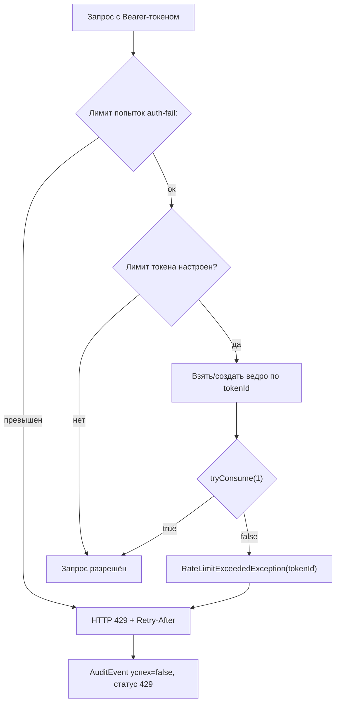

# Rate limiting

Каждый токен может иметь собственный лимит: «не более **N** запросов за **W** секунд».
Лимит задаётся при создании токена и применяется при каждой аутентификации по этому токену.
Дополнительно работает **пре-аутентификационное** ограничение попыток по префиксу — оно
отсекает перебор до дорогой проверки Argon2 (см. ниже).

## Как задать лимит

```bash
curl -u demo:demo -H 'Content-Type: application/json' \
  -d '{
        "name": "ci-bot",
        "scopes": ["payments:read"],
        "rateLimitRequests": 100,
        "rateLimitWindowSeconds": 60
      }' \
  http://localhost:8080/api/openapi/tokens
```

| Поле запроса | Тип | Описание |
|---|---|---|
| `rateLimitRequests` | `Integer` | Число запросов в окне |
| `rateLimitWindowSeconds` | `Integer` | Длина окна в секундах |

Лимит считается **настроенным**, только если заданы **оба** поля. Полу-заданная политика
не превращается молча в «безлимит»:

| Что передано | Результат |
|---|---|
| оба поля, положительные | `RateLimitPolicy.of(requests, windowSeconds)` — лимит применяется |
| ничего | `RateLimitPolicy.unlimited()` — запросы не ограничиваются |
| только одно поле | **400** `Validation Failed` («rateLimitRequests and rateLimitWindowSeconds must be provided together») |
| `<= 0` | **400**: DTO требует `@Positive`, а конструктор `RateLimitPolicy` бросает `IllegalArgumentException` |

Отдельного эндпоинта для изменения лимита у существующего токена нет: чтобы поменять лимит,
нужно отозвать токен и выпустить новый (или изменить строку в БД напрямую:
`rate_limit_requests`, `rate_limit_window_seconds`).

## Алгоритм

Реализация — `Bucket4jRateLimiter` на библиотеке **Bucket4j 8.14.0**, in-memory:

```java
Bandwidth limit = Bandwidth.builder()
        .capacity(policy.requests())
        .refillGreedy(policy.requests(), Duration.ofSeconds(policy.windowSeconds()))
        .build();
```

- **Ёмкость** = `requests` (максимальный «запас» токенов ведра).
- **Пополнение** — *greedy* (жадное): ведро пополняется непрерывно, со скоростью
  `requests / windowSeconds` в секунду, а не «пачкой» в начале окна. То есть при
  `100 запросов / 60 c` после всплеска восстанавливается примерно 1.67 запроса в секунду.
- Каждое обращение пытается израсходовать ровно 1 единицу (`tryConsume(1)`).
- Ведро живёт в `ConcurrentHashMap` и ключуется **только идентификатором токена**
  (`tokenId.toString()`), без параметров политики.
- Карта **ограничена**: по умолчанию не более **10 000** ведёр
  (`Bucket4jRateLimiter.DEFAULT_MAX_BUCKETS`), при превышении вытесняются least-recently-used.
  Это закрывает бесконечный рост памяти на отозванных токенах.
- Если политика токена меняется (`requests`/`window`), ведро пересобирается **под тем же
  ключом** — старое ведро не «утекает» как отдельная запись со старым ключом
  `tokenId:requests:window` (так было раньше). Счётчик при пересборке начинается заново.
- Есть перегрузка `tryAcquire(String key, …)` — она используется для
  пре-аутентификационного троттлинга (ключи вида `auth-fail:<prefix>`), см. ниже.



## Пре-аутентификационное ограничение

Отдельный лимит защищает от перебора префиксов/секретов: он проверяется **до** поиска
токена в БД и **до** вычисления Argon2, поэтому не даёт «сжигать» CPU на каждом неверном
секрете.

```yaml
openapi:
  tokens:
    auth:
      failed-attempt-limit: 60           # попыток на префикс за окно; 0 = выключено
      failed-attempt-window-seconds: 60
```

| Свойство | По умолчанию | Смысл |
|---|---|---|
| `openapi.tokens.auth.failed-attempt-limit` | `60` | максимум попыток на один префикс за окно; `0` отключает троттлинг |
| `openapi.tokens.auth.failed-attempt-window-seconds` | `60` | длина окна в секундах |

Механика:

- ключ ведра — `auth-fail:<prefix>` из разобранного `atk_<prefix>_<secret>`;
- **счётчик расходуется только на неуспешные попытки** (неизвестный префикс, нерабочий/просроченный
  токен, неверный секрет). Успешная аутентификация бюджет не тратит, поэтому busy-токен не
  «придушивает» сам себя;
- перед проверкой хеша выполняется **нерасходующая** проверка `RateLimiter#isExhausted`: если
  бюджет уже исчерпан, запрос получает **429** (`RateLimitExceededException` без `tokenId` —
  токен ещё не искали, поэтому в аудите `tokenId = null`) и Argon2 не запускается;
- после того как неуспешные попытки исчерпали окно, префикс «остывает» в течение
  `failed-attempt-window-seconds`.

!!! warning "Пре-аутентификационный лимит — это не замена пер-токенному"
    Он ограничивает попытки **по префиксу**, а не по токену, и не знает политику токена.
    Используйте его как «щит» перед Argon2, а основной лимит задавайте в самом токене
    (`rateLimitRequests` / `rateLimitWindowSeconds`).

## Поведение при превышении

| Что | Значение |
|---|---|
| HTTP-статус | **429 Too Many Requests** |
| `Content-Type` | `application/problem+json` |
| Тело ответа | JSON `{"status":429,"title":"Too Many Requests","detail":"Rate limit exceeded"}` |
| Заголовок `Retry-After` | **отдаётся**, значение — `openapi.tokens.rate-limit.retry-after-seconds` (по умолчанию 60) |
| Заголовки остатка квоты (`X-RateLimit-*`) | **не отдаются** |
| Аудит | запись с `success = false`, `responseStatus = 429`, `action = "AUTHENTICATE"`, `tokenId` заполнен для пер-токенного лимита и `null` для пре-аутентификационного |
| Тип исключения | `RateLimitExceededException` (наследник `AuthenticationException`), у пер-токенного — с `tokenId` |

Так как `RateLimitExceededException` — это `AuthenticationException`, фильтр различает
его отдельной ветвью `catch` и отдаёт 429 вместо 401.

## Конфигурация

```yaml
openapi:
  tokens:
    rate-limit:
      backend: memory        # объявлено в свойствах, но НЕ используется
      retry-after-seconds: 60  # значение заголовка Retry-After в 429 (1…86400)

    auth:
      failed-attempt-limit: 60           # 0 = пре-аутентификационный троттлинг выключен
      failed-attempt-window-seconds: 60
```

| Свойство | По умолчанию | Используется? |
|---|---|---|
| `openapi.tokens.rate-limit.retry-after-seconds` | `60` | да — значение `Retry-After` в 429 |
| `openapi.tokens.auth.failed-attempt-limit` | `60` | да — попыток на `auth-fail:<prefix>` (`0` = выключено) |
| `openapi.tokens.auth.failed-attempt-window-seconds` | `60` | да — окно пре-аутентификационного лимита |
| `openapi.tokens.rate-limit.backend` | `memory` | **нет** — см. ниже |

!!! warning "`rate-limit.backend` — по-прежнему мёртвая настройка"
    Свойство `openapi.tokens.rate-limit.backend` присутствует в `OpenApiTokensProperties`,
    однако нигде не читается: бин `RateLimiter` всегда создаётся как `Bucket4jRateLimiter`
    и всегда in-memory. Указание `redis` или любого другого значения ни на что не влияет.

Чтобы получить распределённый лимит, нужно зарегистрировать свой бин `RateLimiter`
(например, на Redis/Bucket4j-Redis, Hazelcast или через шлюз) — он подхватится
благодаря `@ConditionalOnMissingBean`. См. [Порты и SPI](../api/spi.md).

## Ограничения текущей реализации

| Ограничение | Следствие | Что делать |
|---|---|---|
| In-memory `ConcurrentHashMap` | В кластере из N узлов фактический лимит ≈ N × `requests` | Внешнее хранилище или лимит на уровне API-gateway |
| Ведра вытесняются по LRU после 10 000 | При большом числе активных токенов «старое» ведро может быть вытеснено и создано заново — счётчик сбросится | Свой `RateLimiter` с настраиваемым размером/TTL; либо поднять `maxBuckets`, создав бин вручную |
| Изменение политики пересобирает ведро | `requests`/`window` меняются только правкой БД; после пересборки счётчик начинается заново | Не менять политику «на ходу»; учесть при прямых правках БД |
| Пре-аутентификационный лимит общий на префикс | Считает только **неуспешные** попытки (успешные бюджет не тратят), но окно у префикса одно | Поднять `failed-attempt-limit`, отключить (`0`) или опираться на пер-токенный лимит |
| Лимит только для `atk_`-токенов | Запросы по Basic/сессии/Keycloak этим механизмом не ограничиваются | Лимиты для остальных механизмов — средствами продукта |
| Нет «мягких» уведомлений | Клиент узнаёт о лимите только по 429 | `Retry-After` уже отдаётся; остальные заголовки (`X-RateLimit-*`) — в своём фильтре-обёртке |
| Нет глобального лимита | Ограничение всегда пер-токенное | Общий лимит — на уровне шлюза |
| Ведра не удаляются при отзыве немедленно | После отзыва токена ведро ещё живёт в памяти до LRU-вытеснения | Ограничение по памяти снято (10 000 ведёр); при необходимости вызывайте `reset(key)` из своего кода |

## Тестирование

Поведение покрыто модульными тестами `Bucket4jRateLimiterTest` (с подменяемым `TimeMeter`,
чтобы не зависеть от реального времени): проверяются изоляция по токенам, смена политики,
строковые ключи `auth-fail:*`, LRU-вытеснение, `isExhausted` и `reset`. Для интеграционной проверки удобно
задать «жёсткий» лимит и вызвать защищённый эндпоинт дважды:

```bash
TOKEN=$(curl -s -u demo:demo -H 'Content-Type: application/json' \
  -d '{"name":"rl","scopes":["payments:read"],"rateLimitRequests":1,"rateLimitWindowSeconds":3600}' \
  http://localhost:8080/api/openapi/tokens | jq -r .rawToken)

curl -s -D- -o /dev/null -H "Authorization: Bearer $TOKEN" http://localhost:8080/api/demo/payments  # 200
curl -s -D- -H "Authorization: Bearer $TOKEN" http://localhost:8080/api/demo/payments              # 429 + Retry-After
```

## Связанные разделы

- [Аутентификация](security.md) — место проверки лимита в цепочке.
- [Аудит](audit.md) — как фиксируются отказы по лимиту.
- [Порты и SPI](../api/spi.md) — свой `RateLimiter`.
