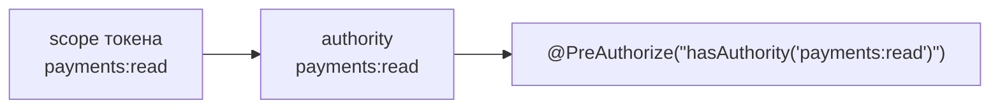
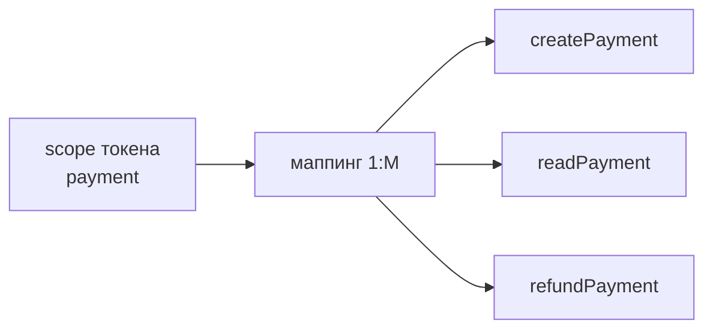

# Скоупы и права

Скоуп — это строка, которая ограничивает, что токену разрешено делать. Библиотека поддерживает
две модели преобразования скоупов токена в **права (authority) Spring Security**.

| Модель | Режим | Соответствие | Когда использовать |
|---|---|---|---|
| Прямая | `identity` | 1:1 — `scope` токена становится authority как есть | Приложение уже мыслит «скоупами API»; простой публичный API |
| Маппинг | `mapped` | 1:M — один скоуп токена разворачивается в набор authority | Внутренние права приложения отличаются от внешних скоупов; нужен слой совместимости |

```yaml
openapi:
  tokens:
    scopes:
      mode: identity   # identity | mapped
```

---

## Режим `identity` (по умолчанию)



`IdentityScopeResolver` возвращает тот же набор строк. Пример из демо-приложения:

```java
@GetMapping("/payments")
@PreAuthorize("hasAuthority('payments:read')")
public List<Payment> payments() { … }
```

Плюсы: нулевая конфигурация, понятная модель. Минусы: «внешние» имена скоупов становятся
именами прав в коде — переименование прав ломает уже выпущенные токены.

## Режим `mapped`



Скоупы токена разворачиваются через `ScopeMappingSource`:

```yaml
openapi:
  tokens:
    scopes:
      mode: mapped
      mappings:
        payment:
          - createPayment
          - readPayment
          - refundPayment
        report:
          - readReport
```

Если пользователь выпускает токен со скоупом `payment`, в security context попадут три
authority — и заработают привычные проверки:

```java
@PreAuthorize("hasAuthority('createPayment')")
```

### Приоритет источников маппингов

`CompositeMappingSource` объединяет конфигурацию и таблицу `scope_mapping`:

| Ситуация | Что применяется |
|---|---|
| В `scope_mapping` есть хотя бы одна строка для `tokenScope` | **Только строки из БД** (конфиг для этого скоупа игнорируется) |
| В БД строк нет | Значение из `openapi.tokens.scopes.mappings` |
| Нет ни в БД, ни в конфиге | Пустой набор authority → токен **не аутентифицируется**: `reject-empty-authorities` (по умолчанию `true`) отклоняет «пустой» principal |

!!! warning "Строка в БД полностью перекрывает конфиг"
    Достаточно одной записи в `scope_mapping` для скоупа `payment`, чтобы конфигурационные
    маппинги `payment` перестали применяться. Это удобно для «горячей» правки прав,
    но опасно при частичном заполнении таблицы — легко случайно сузить права.

    Из-за fail-closed поведения (`reject-empty-authorities: true`) полностью «опустошённый»
    маппинг приводит не к «токену без прав», а к **401 на каждом запросе**. Проверяйте
    маппинги после правок; для отладки можно временно вернуть легаси-поведение
    `openapi.tokens.auth.reject-empty-authorities=false`.

### Тенантность маппингов

Запрос к `scope_mapping` (JPQL в `ScopeMappingJpaRepository`):

```sql
SELECT m FROM ScopeMappingEntity m
WHERE m.tokenScope IN :tokenScopes
  AND (m.tenantId IS NULL OR m.tenantId = :tenantId)
```

- строка с `tenant_id IS NULL` — общая для всех тенантов;
- строка с `tenant_id = 'tenant-a'` — только для тенанта `tenant-a`;
- тенант берётся из `ApiToken#tenantId`, который заполняется при создании токена.

Тот же `tenantId` (из `ApiToken#tenantId` / владельца) передаётся в `ScopeResolver`
при аутентификации и в `CallerAuthorityScopeValidator` при создании токена, поэтому
`mapped`-права могут отличаться по тенантам. Справочник же запрашивается с
`tenantId = null`, то есть показывает только глобальные маппинги.

`DefaultScopeCatalog.listScopes()` резолвит project-authority **одним батчевым запросом**
(`ScopeMappingSource.projectScopesFor(Set<String>, tenantId)`, внутри — один
`SELECT … WHERE token_scope IN (:scopes) AND (tenant_id IS NULL OR tenant_id = :tenantId)`),
а не по запросу на скоуп. Ограничение сохраняется: справочник вызывает
`projectScopesFor(scopes, null)`, поэтому тенант-специфичные строки
(`tenant_id = 'tenant-a'`) в нём **не видны** — остаются только глобальные
(`tenant_id IS NULL`). Описания и имена скоупов от тенанта не зависят.

### Тенант из запроса (`allow-tenant-override`)

Поле `tenantId` в `POST /api/openapi/tokens` по умолчанию **не позволяет** выйти за
пределы тенанта владельца:

```yaml
openapi:
  tokens:
    scopes:
      allow-tenant-override: false   # по умолчанию
```

| `allow-tenant-override` | `tenantId` в запросе | Результат |
|---|---|---|
| `false` | не задан / пустой | тенант владельца |
| `false` | совпадает с тенантом владельца | тенант владельца (значение принимается) |
| `false` | **отличается** от тенанта владельца | **403** `TenantNotAllowedException`, ProblemDetail title `Tenant Not Allowed` |
| `true` | любой непустой | легаси-поведение: берётся ровно то, что передал клиент |

Значение тримится. Сравнение строк точное. Проверка выполняется **до** валидации скоупов,
квоты и генерации секрета, поэтому при 403 ничего не сохраняется.

!!! warning "Сравнение тенантов — строковое"
    Если у владельца `tenantId = null`, любой непустой `tenantId` в запросе считается
    «чужим» и даёт 403 (пока `allow-tenant-override: false`). Учитывайте это при
    `internal`-режиме: там тенант владельца всегда `null`.

---

## Справочник скоупов

`ScopeCatalog` — единая точка «какие скоупы существуют и что они значат». Это read-API для
UI создания токена, страницы документации и админ-консоли.

```java
@Autowired ScopeCatalog scopeCatalog;

List<ScopeInfo> scopes = scopeCatalog.listScopes();
// ScopeInfo(scope, description, projectScopes)
// → ScopeInfo("payment:read", "Чтение платежей", Set.of("readPayment"))
```

### Источники описаний и приоритет

| Приоритет | Источник | Где задаётся |
|---|---|---|
| 1 (высший) | Таблица `scope_catalog` | миграция `V2__scope_catalog.sql`, `scope` PK + `description` |
| 2 | Конфигурация | `openapi.tokens.scopes.catalog` |
| 3 | Маппинги | `ScopeMappingSource` — добавляют скоупы в список, даже если описания нет |

Итоговый список — **объединение** описанных скоупов и скоупов, известных из маппингов,
отсортированное по имени (`TreeSet`). Скоуп без описания возвращается с `description: null`;
скоуп без маппинга — с пустым `projectScopes`.

### Конфигурация: двоеточие в ключе

!!! danger "Ключи со `:` в YAML — только в квадратных скобках"
    ```yaml
    openapi:
      tokens:
        scopes:
          catalog:
            "[payments:read]": "Чтение платежей"   # ✅ правильно
            payments:read: "Чтение платежей"       # ❌ Spring потеряет ':' при биндинге Map<String,String>
    ```
    Без скобок Spring Boot отбрасывает часть ключа после `:` (он воспринимает её как разделитель),
    и в каталоге появляются «битые» скоупы вида `payments`. Это самая частая ошибка конфигурации.

### Доступ к справочнику

=== "REST"

    ```bash
    curl -u demo:demo http://localhost:8080/api/openapi/scopes
    ```

    ```json
    [
      {
        "scope": "payments:read",
        "description": "Чтение платежей — открывает GET /api/demo/payments",
        "projectScopes": []
      }
    ]
    ```

=== "Java"

    ```java
    @Autowired ScopeCatalog catalog;
    List<ScopeInfo> all = catalog.listScopes();
    ```

=== "UI (демо)"

    Страница `/ui/scopes`; описания также показываются подсказками в форме `/ui/tokens/new`.

---

## Валидация скоупов при создании токена

Запрошенные скоупы проверяются **до** создания токена и по умолчанию **fail-closed**.
Точка расширения — SPI `ru.openapi.tokens.token.spi.ScopeValidator`:

```java
@FunctionalInterface
public interface ScopeValidator {
    void validate(ScopeValidationContext context);   // InvalidScopeException → отказ
}
```

Контекст `ru.openapi.tokens.token.ScopeValidationContext`:

| Поле | Тип | Смысл |
|---|---|---|
| `ownerId` | `String` | владелец будущего токена |
| `tenantId` | `String` | эффективный тенант (уже после проверки `allow-tenant-override`) |
| `requestedScopes` | `Set<String>` | запрошенные скоупы (trim, без дублей) |
| `callerAuthorities` | `Set<String>` | authority вызывающего из security context (может быть пустым) |
| `privileged` | `boolean` | `true`, если вызывающий вправе делегировать любые скоупы |

При отказе бросается `InvalidScopeException`
(`ru.openapi.tokens.token.exception`), у которой есть машинно-читаемые
`getReason()` и `getInvalidScopes()`:

| `Reason` | Когда возникает |
|---|---|
| `UNKNOWN_SCOPE` | скоупа нет в справочнике `ScopeCatalog` |
| `DENIED_SCOPE` | скоуп совпал с `deny-patterns` (по умолчанию `ROLE_.*`) |
| `NOT_GRANTABLE` | вызывающий сам не обладает authority, которое получит токен (`strict`) |

Реализации и режимы:

| Класс | Что проверяет |
|---|---|
| `NoOpScopeValidator` | ничего (принимает всё) |
| `DenyPatternScopeValidator` | скоупы не совпадают с `deny-patterns` |
| `CatalogScopeValidator` | **каждый** скоуп есть в `ScopeCatalog` |
| `CallerAuthorityScopeValidator` | `ScopeResolver.resolve(scopes)` ⊆ `callerAuthorities` |
| `CompositeScopeValidator` | вызывает валидаторы по порядку, первая ошибка побеждает |

`openapi.tokens.scopes.validation.mode` (`ScopeValidationMode`) собирает композицию:

| `mode` | Состав |
|---|---|
| `off` | `ScopeValidator.allowAll()` — валидации нет |
| `deny-list` | `DenyPatternScopeValidator` |
| `catalog` (по умолчанию) | `DenyPattern` + `Catalog` |
| `strict` | `DenyPattern` + `Catalog` + `CallerAuthority` |

```yaml
openapi:
  tokens:
    scopes:
      validation:
        mode: catalog            # off | deny-list | catalog | strict (по умолчанию catalog)
        deny-patterns:           # применяется при любом mode, кроме off
          - "ROLE_.*"
        privileged-authorities:  # кому можно делегировать что угодно (учитывается только в strict)
          - "ROLE_ADMIN"
```

Порядок шагов в `DefaultApiTokenService#create`:

1. определение владельца (`TokenOwnerResolver`);
2. проверка тенанта (`allow-tenant-override` → `TenantNotAllowedException`, HTTP 403);
3. **валидация скоупов** (`ScopeValidator`);
4. advisory-lock владельца и проверка квоты;
5. генерация секрета и хеширование.

Валидация стоит **раньше** проверки квоты и генерации секрета: при отказе ничего не
записывается в БД, слот квоты не расходуется, а сырой секрет вообще не создаётся.
REST-ответ — **422 Unprocessable Entity** (`ApiTokenExceptionHandler`) с `ProblemDetail`
и машинно-читаемыми свойствами:

```json
{
  "type": "about:blank",
  "title": "Invalid Scopes",
  "status": 422,
  "detail": "Invalid scopes (DENIED_SCOPE): [ROLE_ADMIN]",
  "reason": "DENIED_SCOPE",
  "invalidScopes": ["ROLE_ADMIN"]
}
```

!!! warning "`catalog` ≠ `strict`: подумайте о мощных скоупах"
    По умолчанию (`catalog`) проверяется только существование скоупа в справочнике и
    `deny-patterns`. Если в справочнике есть «мощные» скоупы (`admin:all`,
    `payments:write`), любой аутентифицированный пользователь сможет выпустить токен
    с ними. Режим `strict` дополнительно требует, чтобы спроецированные authority
    (`ScopeResolver`: в `identity` — сам скоуп, в `mapped` — маппинги) уже были у
    вызывающего. `privileged-authorities` (по умолчанию `ROLE_ADMIN`) обходят эту
    проверку.

    Почему `strict` не сделан режимом по умолчанию: роли вызывающего (например,
    `ROLE_USER`) обычно **не совпадают** со скоупами токена (`payments:read`), и
    `strict` «из коробки» отклонял бы легитимные запросы. Включайте его осознанно —
    прежде всего там, где справочник содержит сильные скоупы.

!!! warning "`off`, пустые `deny-patterns` и пустой справочник ослабляют защиту"
    - `mode: off` полностью отключает проверку — произвольные скоупы снова становятся
      authority (см. [Повышение привилегий](security.md#повышение-привилегий-через-скоупы)).
    - Если `deny-patterns` очищен, скоуп `ROLE_ADMIN` перестаёт отсекаться
      deny-правилом, а `catalog` пропустит его, если он есть в справочнике.
    - `DenyPatternScopeValidator` сравнивает скоуп с pattern через `matches()`
      (полное совпадение строки), поэтому `ROLE_.*` не поймает `role_admin`
      в другом регистре: регистр в скоупах не нормализуется.

Своя политика подключается заменой бина `ScopeValidator` (благодаря
`@ConditionalOnMissingBean`), см. [Порты и SPI](../api/spi.md).

## Нормализация и регистр

- `ApiToken` при создании делает `trim()` каждого скоупа, удаляет пустые и дубликаты
  (`LinkedHashSet`), бросает `EmptyScopesException`, если набор пуст.
- Регистр **не** нормализуется: `payments:read` и `Payments:Read` — разные скоупы.
- Сравнение в БД (`IN`, `=`) чувствительно к регистру и пробелам, поэтому `tenant_id`/`scope`
  из внешних источников стоит тримить и приводить к единому регистру до записи.

## Связанные разделы

- [Аутентификация и авторизация](security.md) — как authority попадают в security context.
- [Жизненный цикл токена](token-lifecycle.md) — квота и порядок шагов при создании.
- [Порты и SPI](../api/spi.md) — как подменить `ScopeResolver`, `ScopeCatalog` и `ScopeValidator`.
- [Модель данных](../architecture/data-model.md) — таблицы `scope_mapping`, `scope_catalog`.
