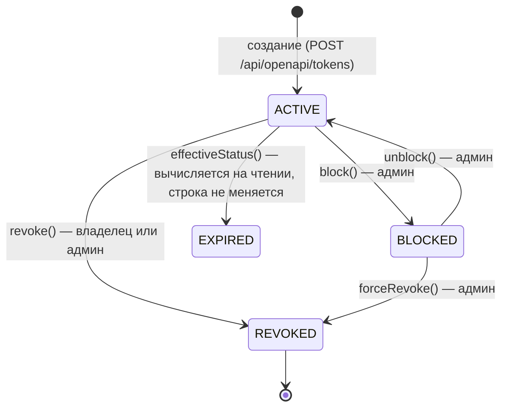
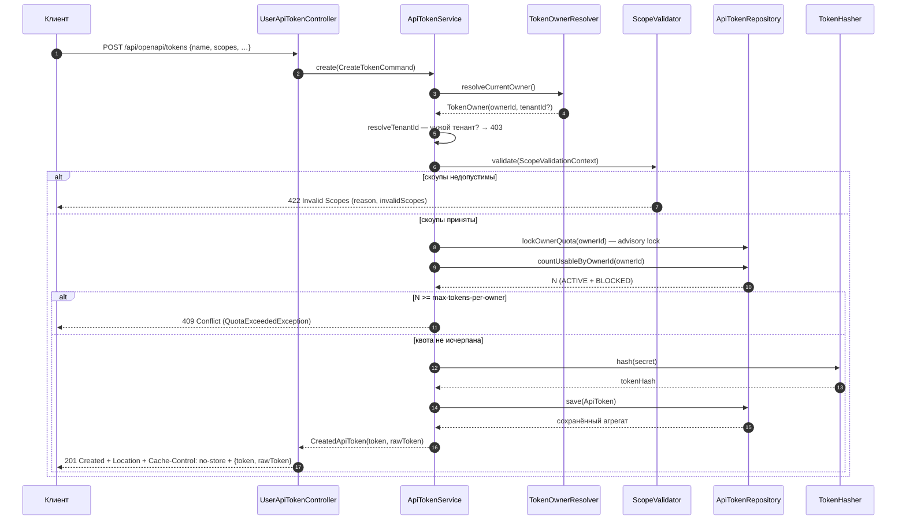

# Жизненный цикл токена

Раздел описывает, как токен создаётся, живёт, перестаёт работать и отзывается: статусы,
правила переходов, сроки жизни (TTL), квоты и что именно проверяется на каждом запросе.

## Статусы токена



| Статус | Значение | Можно аутентифицироваться | Кто переводит |
|---|---|---|---|
| `ACTIVE` | Токен работает | ✅ да (если не истёк TTL) | создание; разблокировка |
| `BLOCKED` | Временно отключён администратором, обратим | ❌ нет | админ: `block` |
| `REVOKED` | Отозван навсегда, необратимо | ❌ нет | владелец: `revoke`; админ: `forceRevoke` |
| `EXPIRED` | Истёк по сроку | ❌ нет | **вычисляется** из TTL, см. примечание |

!!! warning "Хранимый статус остаётся `ACTIVE`, «эффективный» — `EXPIRED`"
    Фонового задания, которое переписывало бы строки, по-прежнему нет: метод
    `ApiToken#markExpired()` в production-коде не вызывается. Вместо этого домен умеет
    **выводить** статус на чтении:

    ```java
    TokenStatus effective = token.effectiveStatus(clock.instant());
    // ACTIVE + истёк TTL → EXPIRED; остальные статусы возвращаются как есть
    ```

    `ApiTokenResponse` отдаёт **два** поля:

    | Поле | Источник | Пример |
    |---|---|---|
    | `status` | хранимая колонка `api_token.status` | `ACTIVE` |
    | `effectiveStatus` | `ApiToken#effectiveStatus(now)` | `EXPIRED` |

    Что это меняет:

    - UI/отчёты могут отличать «живой» токен от просроченного по `effectiveStatus`,
      не сравнивая `expiresAt` вручную (старые клиенты могут продолжать смотреть на
      `status`);
    - просроченный токен по-прежнему **не проходит аутентификацию**
      (`DefaultApiTokenAuthenticator` проверяет `expiry.isExpired(clock)` на каждом запросе);
    - фоновой «уборки» строк нет — таблица хранит их до ручной очистки.

## Правила переходов

Переходы защищены инвариантами в домене (`ApiToken`), нарушение даёт `InvalidTokenStateException`
(HTTP 400 через `ApiTokenExceptionHandler`):

| Операция | Разрешена из статуса | Сообщение об ошибке |
|---|---|---|
| `revoke()` | любой, кроме `REVOKED` | `Token already revoked` |
| `block()` | только `ACTIVE` | `Only ACTIVE tokens can be blocked` |
| `unblock()` | только `BLOCKED` | `Only BLOCKED tokens can be unblocked` |
| `touchLastUsed()` | только `ACTIVE` (`isUsable()`) | `Cannot touch non-active token` |

!!! note "Повторный отзыв: `204` у владельца, `400` у админа"
    Домен `revoke()` для уже отозванного токена бросает `InvalidTokenStateException`.
    Пользовательский `DELETE /api/openapi/tokens/{id}` **перехватывает** это исключение и
    возвращает **204 No Content**, поэтому операция идемпотентна для ретраев.

    Админский `DELETE /api/openapi/admin/tokens/{id}` (`forceRevoke`) исключение **не**
    перехватывает — повторный вызов вернёт **400**. Учитывайте это в скриптах
    администрирования.

    Отдельный нюанс: если токен успели изменить параллельно, `save()` может бросить
    `ConcurrentTokenModificationException` → **409** (см. «Конкурентный доступ»).

## Создание токена

Последовательность:



Что происходит по шагам:

1. **Владелец** определяется через `TokenOwnerResolver` из текущего security context
   (`ownerId`, при наличии — `tenantId`).
2. **Тенант**: если `tenantId` передан и не совпадает с тенантом владельца, а
   `openapi.tokens.scopes.allow-tenant-override=false` (по умолчанию) →
   `TenantNotAllowedException` → HTTP **403** `Tenant Not Allowed`.
3. **Валидация скоупов** (`ScopeValidator`): режим `catalog` по умолчанию отклоняет
   неизвестные скоупы и `ROLE_.*` → `InvalidScopeException` → HTTP **422**
   `Invalid Scopes`. До записи в БД и до генерации секрета.
4. **Квота**: под advisory-lock владельца считается `countUsableByOwnerId(ownerId)`
   (только `ACTIVE` + `BLOCKED`); при `>= max-tokens-per-owner` →
   `QuotaExceededException` → HTTP **409 Conflict**.
5. **TTL**: если клиент не передал ни `expiresAt`, ни `slidingTtlSeconds`, подставляется
   `openapi.tokens.token.default-ttl` (по умолчанию 90 дней).
6. **Генерация секрета**: `RawToken.generate(prefixLength)` — префикс из `prefixLength`
   hex-символов (по умолчанию 8) и секрет из 32 случайных байт (`SecureRandom`), закодированный
   в hex (64 символа).
7. **Хеширование**: `TokenHasher#hash(secret)`; в БД попадает только тегированный хеш.
8. **Сборка агрегата**: `scopes` нормализуются (trim, дубликаты убираются, пустой набор запрещён),
   `createdBy = ownerId`, `createdAt = now`, статус по умолчанию `ACTIVE`, `tenantId` — из команды,
   иначе из владельца.
9. **Сохранение** и возврат пары «агрегат + сырой токен». Событие `CREATE_TOKEN` пишется
   в аудит (status 201).

Ответ содержит `rawToken` — **единственный** момент, когда секрет доступен в открытом виде,
поэтому ответ создания помечен `Cache-Control: no-store`.

### Квота: важные детали

`countUsableByOwnerId` считает только **используемые** статусы — `ACTIVE` и `BLOCKED`
(`JpaApiTokenRepository.QUOTA_STATUSES`). Поэтому:

- отзыв (`REVOKED`) **освобождает слот**: чтобы выпустить токен «взамен» отозванного,
  квоту поднимать не нужно;
- `BLOCKED`-токен слот **занимает** — блокировка обратима;
- эффективно просроченный токен (`effectiveStatus = EXPIRED`), у которого в БД всё ещё
  `ACTIVE`, слот **занимает**: фонового перевода в `EXPIRED` нет.

Конкурентные создания сериализуются на владельце: перед подсчётом вызывается
`ApiTokenRepository#lockOwnerQuota(ownerId)`, в JPA-адаптере это транзакционный
advisory-lock PostgreSQL (`pg_advisory_xact_lock(hashtext(ownerId))`), снимаемый в конце
транзакции. Без него два параллельных запроса могли бы «проскочить» квоту.

### Конкурентный доступ и оптимистическая блокировка

В `api_token` добавлена колонка `version` (миграция `V3__hardening.sql`) и `@Version` в
JPA-сущности. Если строку изменил другой запрос между чтением и записью,
`OptimisticLockingFailureException` транслируется в `ConcurrentTokenModificationException`
→ HTTP **409** `Concurrent Modification` (ProblemDetail). Трансляцию делает
`TransactionalApiTokenService` для `create`, `revoke`, `block`, `forceRevoke`,
`forceBlock`, `touchLastUsed`.

## Сроки жизни (TTL)

TTL задаётся при создании (`TokenExpiry`). Если клиент не передал **ничего**, применяется
TTL по умолчанию:

```yaml
openapi:
  tokens:
    token:
      default-ttl: 90d    # применяется, когда нет ни expiresAt, ни slidingTtlSeconds
```

| Режим | Поля запроса | Поведение |
|---|---|---|
| **По умолчанию** | ни `expiresAt`, ни `slidingTtlSeconds` | `expiresAt = now + default-ttl` (90 дней); фактически это абсолютный TTL |
| **Абсолютный** | `expiresAt = 2026-01-01T00:00:00Z` | Токен недействителен, начиная с `expiresAt` (проверка `!now.isBefore(expiresAt)`) |
| **Скользящий** | `slidingTtlSeconds = 3600` | Недействителен, если с момента последнего успешного использования прошло больше указанного интервала; «якорь» — `createdAt`, пока не было обращений |
| **Комбинированный** | оба поля | Срабатывает то ограничение, которое наступит раньше |

```mermaid
gantt
    title Скользящий TTL (3600 c) продлевается при обращениях
    dateFormat X
    axisFormat %s
    section Токен
    создан           :0, 1
    обращение        :1, 1
    обращение        :2, 1
    окно после посл. :3, 4
```



Логика проверки (`TokenExpiry#isExpired(Clock)`):

- если задан `expiresAt` и `now >= expiresAt` → **просрочен**;
- если задан `slidingTtl`: «якорь» = `lastUsedAt`, а если его нет — `createdAt`;
  просрочен, если `now >= anchor + slidingTtl`;
- иначе не просрочен.

Скользящее окно продлевается вызовом `touchLastUsed` при **каждой успешной**
аутентификации — до проверки прав и выполнения запроса.

!!! info "`default-ttl` применяется только при полном отсутствии TTL в запросе"
    `DefaultApiTokenService#expiryFor` подставляет `now + default-ttl` **только** когда
    `expiresAt == null` **и** `slidingTtl == null`. Явный `expiresAt` или
    `slidingTtlSeconds` полностью перекрывает настройку. Чтобы вернуть «бессрочные»
    токены, задайте своё значение `default-ttl` (свойство `@NotNull`, «выключить» его
    через `null` нельзя) или создавайте токены через свой сервис.

    Старые токены, выпущенные до харденинга без TTL, остаются бессрочными: миграция их
    не трогает, проверка `expiry.isExpired` для них по-прежнему `false`.

## Проверка токена при обращении

Порядок проверок в `DefaultApiTokenAuthenticator#authenticate` (важен для диагностики):

| # | Проверка | Результат при неудаче |
|---|---|---|
| 1 | Формат `atk_<prefix>_<secret>` (в фильтре, до провайдера) | 401 `Unauthorized` |
| 2 | Пре-аутентификационный лимит попыток `auth-fail:<prefix>` | **429** `Rate limit exceeded` |
| 3 | Поиск по `prefix` в БД | 401 |
| 4 | `status == ACTIVE` | 401 |
| 5 | `!expiry.isExpired(clock)` | 401 |
| 6 | `TokenHasher#matches(secret, tokenHash)` | 401 |
| 7 | Пер-токенный rate limit (`tryAcquire(tokenId, policy)`) | **429** `Rate limit exceeded` |
| 8 | Разрешение скоупов в authority (`ScopeResolver`) | 401, если набор пуст и `reject-empty-authorities=true` |
| 9 | `touchLastUsed` — точечный `UPDATE … WHERE status='ACTIVE'` | — (при гонке просто не продлевается) |
| 10 | Возврат `AuthenticatedToken` | — |

Все неуспешные исходы (кроме 429) отдают **401 без детализации** — нельзя определить,
существовал ли токен вообще. Это сделано намеренно, чтобы не давать информации атакующему.

`touchLastUsed` больше не перечитывает и не сохраняет строку целиком: порт
`ApiTokenRepository#touchLastUsed` выполняет `UPDATE api_token SET last_used_at = … WHERE id = ?
AND status = 'ACTIVE'`. Поэтому параллельный отзыв не может быть «отменён» устаревшим
снимком сущности — токен больше не «воскресает» после revoke.

## Использование токена владельцем

```bash
curl -H "Authorization: Bearer atk_abcd1234_<secret>" \
     http://localhost:8080/api/demo/payments
```

Владелец токена может управлять своими токенами теми же эндпоинтами
(`/api/openapi/tokens`), аутентифицируясь **любым** способом, который поддерживает приложение
(сессия, HTTP Basic, Keycloak, другой API-токен).

## Просмотр и статистика

| Что | Endpoint |
|---|---|
| Список своих токенов | `GET /api/openapi/tokens` |
| Карточка своего токена | `GET /api/openapi/tokens/{id}` |
| Статистика использования | `GET /api/openapi/tokens/{id}/stats` |
| Журнал аудита (по умолчанию 50 записей) | `GET /api/openapi/tokens/{id}/audit?offset=0&limit=50` |
| Все токены (админ) | `GET /api/openapi/admin/tokens?offset=0&limit=100` |
| Любой токен (админ) | `GET /api/openapi/admin/tokens/{id}` |
| Аудит любого токена (по умолчанию 100 записей) | `GET /api/openapi/admin/tokens/{id}/audit?offset=0&limit=100` |

В карточках и списках есть и `status` (хранимый), и `effectiveStatus` (вычисленный,
см. выше). Аудит-эндпоинты поддерживают честные `offset`/`limit`; `limit` ограничен
**500**, значения по умолчанию — 50 (владелец) и 100 (админ).

Доступ к «своим» токенам ограничен владельцем: обращение к чужому токену возвращает
**404 Not Found** (а не 403) — существование чужого токена не раскрывается
(`DefaultApiTokenService#requireOwnedToken`).

## Удаление токенов

Операции физического удаления в API нет. `revoke` — это смена статуса, строка остаётся в БД
вместе с историей аудита. Порт `ApiTokenRepository#deleteById` существует, но production-код
его не вызывает; при прямом удалении строки сработает `ON DELETE CASCADE` для таблицы
`api_token_scope`, а записи в `api_token_audit_log` останутся (внешнего ключа там нет).

## Связанные разделы

- [Скоупы и права](scopes.md) — что именно разрешает токен.
- [Аутентификация](security.md) — как токен превращается в `Authentication`.
- [Rate limiting](rate-limiting.md) — политика «N запросов за окно».
- [Аудит](audit.md) — журнал и статистика.
- [Модель данных](../architecture/data-model.md) — как всё это хранится.
